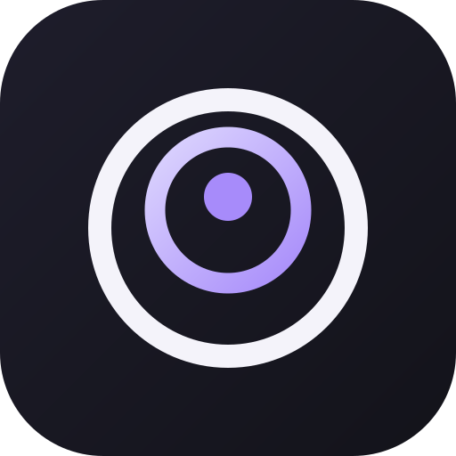
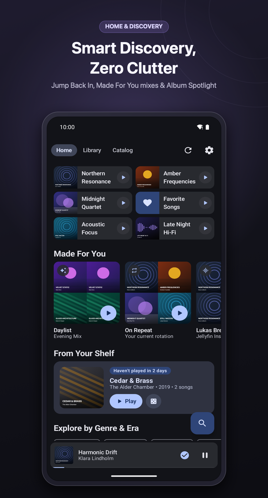
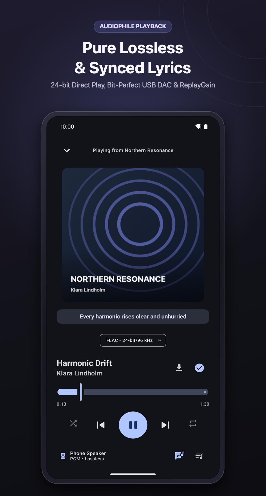
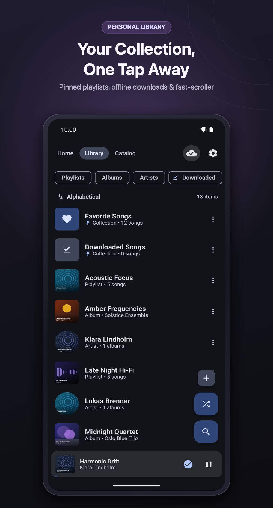
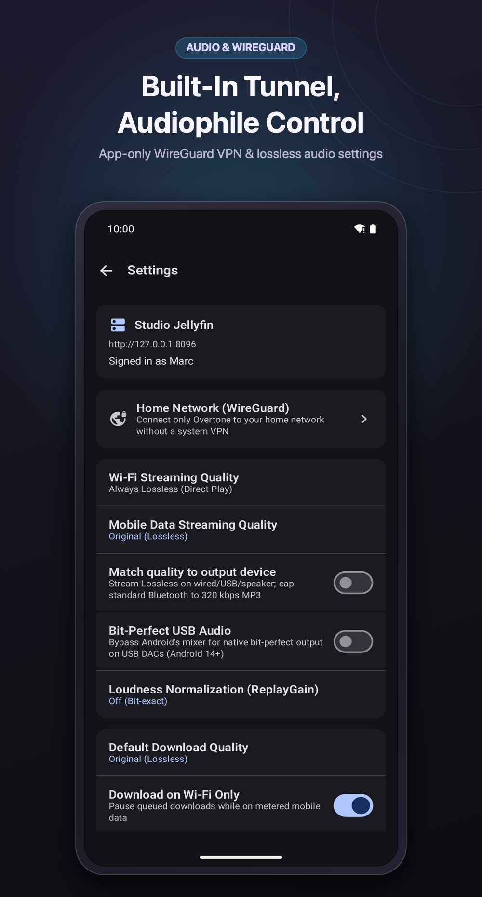

<div align="center">
  

  <h1>Overtone</h1>

  <p>
    <strong>Native audiophile Jellyfin music client for Android</strong><br/>
    Pure Material You · Gapless Lossless Direct Play · Built-In WireGuard · Offline-First
  </p>

  <p>
    <a href="LICENSE"></a>
    <a href="https://github.com/marcscodebase/overtone-android/releases"></a>
    
    
    
    
  </p>

  <p>
    <a href="https://apps.obtainium.imranr.dev/redirect?r=obtainium://add/https://github.com/marcscodebase/overtone-android">
      
    </a>
  </p>

  <p>
    <a href="https://github.com/marcscodebase/overtone-android/releases"></a>
    
  </p>
</div>

---

## Screenshots

<table>
  <tr>
    <td align="center" width="25%">
      
    </td>
    <td align="center" width="25%">
      
    </td>
    <td align="center" width="25%">
      
    </td>
    <td align="center" width="25%">
      
    </td>
  </tr>
</table>

---

## About Overtone

**Overtone** (`io.saier.overtone`) is a native, audiophile Android music client for personal **Jellyfin** servers, built with Kotlin, Jetpack Compose, Pure Material You, and AndroidX Media3.

Overtone is part of a platform-native client family across **Android**, **macOS**, and **GNU/Linux (GNOME)** — embracing each operating system's native look, feel, and ergonomics while maintaining full feature parity.

## Highlights

- **Audiophile Lossless Playback:** Gapless Direct Play (FLAC, ALAC, WAV, AIFF, Opus, AAC, MP3) with 24-bit float PCM output, native **Android 14+ Bit-Perfect USB DAC** support, live seamless quality switching, and custom ReplayGain loudness normalization.
- **3-Zone Home & Smart Discovery:** Compact 2×3 *Jump Back In* speed-dial, *Made For You* smart mixes (*Daylist*, *On Repeat*, live *Jellyfin Instant Mix* with offline fallback, *Time Capsule*, *Deep Cuts*), *Album Spotlight*, Genre & Era mixes, and curated rediscovery shelves.
- **Personal Library & Full Catalog:** Curated Spotify-style personal **Library** with pinning and playlist folders alongside a dedicated **Catalog** tab for browsing huge Jellyfin servers cleanly.
- **Built-In App-Only WireGuard Tunnel:** Embedded `wireguard-go` + `gVisor netstack` userspace tunnel with automatic Home LAN detection, smooth Wi-Fi ↔ mobile data handoffs, and zero Android system VPN slot usage.
- **Offline Downloads & Hybrid MP3 Compression:** Save untouched lossless files or compressed MP3s (server-side transcoding with on-device LAME fallback) to `Music/Overtone/` with embedded artwork, ReplayGain, and synced LRC lyrics.
- **Pure Material You & One-Handed Ergonomics:** Dynamic wallpaper theming (including a Material You monochrome adaptive icon), vertical alphabetical fast-scroller with opposite-side index rail, lockscreen Quick Favorite (`+`/`✓`) control, and optional **Left-Handed Mode**.

> See [doc/features.md](doc/features.md) for the complete code-verified feature reference.

## Installation

### Obtainium (Recommended)
1. Install [Obtainium](https://github.com/ImranR98/Obtainium).
2. Tap the **Get it on Obtainium** badge above — or manually add `https://github.com/marcscodebase/overtone-android`.
3. Obtainium automatically tracks new Semantic Versioning releases (`vX.Y.Z`) and verifies signed APK assets.

### F-Droid
Overtone is 100 % free and open-source software — zero Google Play Services, zero proprietary SDKs, reproducible native builds, and complete Fastlane metadata included — prepared for F-Droid distribution.

## Building from Source

### Prerequisites
- JDK 17+ (e.g. Android Studio JBR or Temurin 17/21)
- Android SDK (API 35) & Android NDK `27.2.12479018`
- Go `1.24+` (for building the embedded userspace WireGuard JNI library)

### Build Steps
```bash
# 1. Build reproducible userspace WireGuard native libraries (arm64-v8a & x86_64)
./wireguard-core/build-android.sh

# 2. Run unit tests
./gradlew testDebugUnitTest

# 3. Build release APK
./gradlew assembleRelease
```

To sign release builds locally, create a gitignored `keystore.properties` (or set `OVERTONE_KEYSTORE_PATH`, `OVERTONE_KEYSTORE_PASSWORD`, `OVERTONE_KEY_ALIAS`, `OVERTONE_KEY_PASSWORD` environment variables).

## License

Overtone is free software licensed under the **GNU General Public License v3.0 or later (`GPL-3.0-or-later`)**. See [LICENSE](LICENSE) for the full text.
